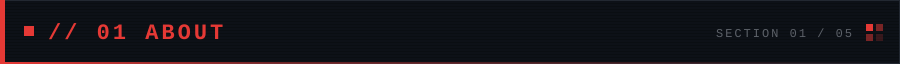
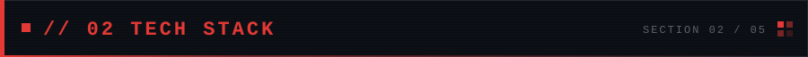
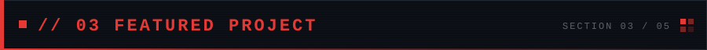
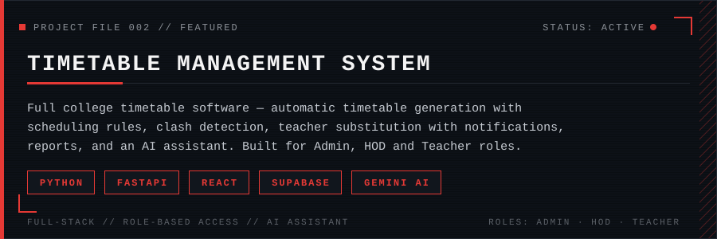
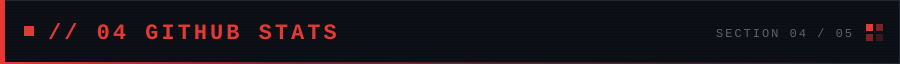
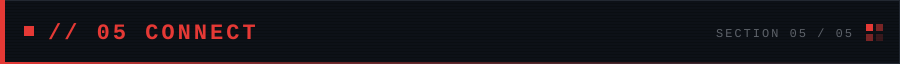
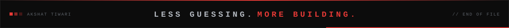

<!-- Akshat Tiwari — GitHub profile README · dark cyberpunk theme (#0D0D0D / #E53935) -->

  

  

  M.Sc. Artificial Intelligence student who builds real, working software. 
  Mobile apps, web apps and admin panels — from the first idea to a finished product. 
  Focus on <b>security</b>, <b>speed</b> and <b>polish</b>: clean code, tested features, no half-done work.

  

  

  

More projects coming soon.

  
  

  

  

  
  &nbsp;
  
  &nbsp;
  

  

<b>UNDERSTAND THE PROBLEM. BUILD THE SOLUTION.</b>

